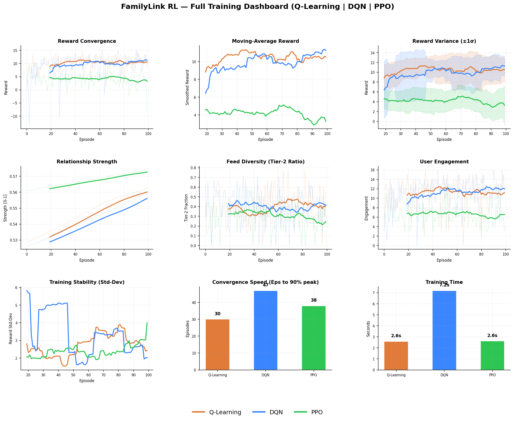
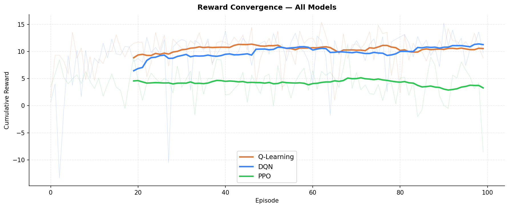
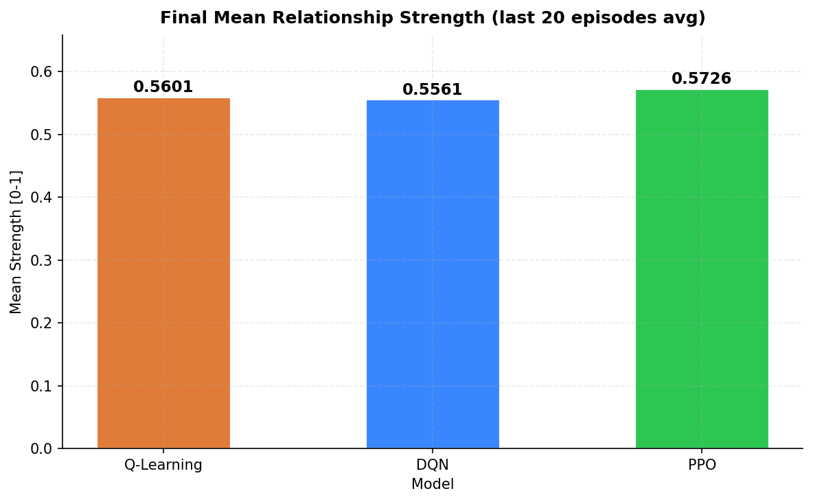

# Personalized Family Feed

**Reinforcement Learning–Based Social Relationship Modeling and Personalized Feed Optimization for Family-Centric Social Networks**

FamilyLink RL treats feed recommendation on a private, family-only social network as a sequential decision problem. An RL agent picks which post to show a user. Each interaction (like, comment, share, skip, dislike) updates a relationship-strength score between the user and the post's author, and those scores feed back into the next recommendations. The environment also enforces privacy rules on who can see what.

Three agents are trained and compared in the same environment: **Tabular Q-Learning**, **Deep Q-Network (DQN)** and **Proximal Policy Optimization (PPO)**. A Streamlit dashboard lets you explore the simulation interactively.

> Course project for **Reinforcement Learning (CS3009)**, IIITDM Kancheepuram, Academic Year 2025–26. Faculty: Dr. Rahul Raman.



---

## Environment: `FamilyLinkEnv`

A custom [Gymnasium](https://gymnasium.farama.org/) environment. One episode is one user session of **20 steps**.

At each step the environment runs: build the candidate feed → apply privacy filtering → build the state → agent picks an action → simulate the user's reaction → compute the reward → update the relationship score.

### Synthetic users and social graph
- 10 families of 3–8 members each. Every user has an age group (child, teen, adult or senior), a device (mobile, tablet or desktop) and an active hour (6–23).
- **Tier 1 (family):** starts at R = 0.70, maximum 1.0, momentum γ = 0.90.
- **Tier 2 (trusted friends from other families):** starts at R = 0.30, trust ceiling 0.85, momentum γ = 0.95.

### Relationship update

```
R_new = γ · R_old + (1 − γ) · (R_old + Δ)
```

| Interaction | Δ |
|---|---|
| Like | +0.05 |
| Comment | +0.10 |
| Share | +0.15 |
| Skip | −0.02 |
| Dislike | −0.10 |

### Privacy model
There is no public content. A post is either:
- **family-only:** visible to the poster's family.
- **trusted-visible:** visible to the poster's family and their Tier-2 trusted connections.

Recommending a post the user cannot see is penalised with a reward of **−5**.

### State (31-dim, values in [0, 1])

| Component | Dim |
|---|---|
| User context (age, device, active hour) | 3 |
| Recent interaction history | 10 |
| Strongest relationship values | 10 |
| Top candidate post encoding | 6 |
| Fatigue (consecutive skips) | 1 |
| Tier-2 share of the feed | 1 |

### Actions (12, discrete)
- 0–9: recommend one of the candidate posts
- 10: Boost
- 11: Pass

### Reward

```
reward = (w1 · E + w2 · I − w3 · F) × tier_discount
```

| Term | Definition |
|---|---|
| **E** (explicit) | Share 3, Comment 2, Like 1, Skip 0, Dislike −1 |
| **I** (implicit) | `0.5·R + 0.3·Quality + 0.2·Recency`, a proxy for dwell time |
| **F** (fatigue) | `α · skips²` |
| **tier_discount** | 1.0 for family posts, `0.6 · trust` for Tier-2 posts |

The weights live in `training/config.py`.

---

## Agents

| Agent | Key ideas |
|---|---|
| **Q-Learning** | Q-table over a discretised state (5 bins per dimension), ε-greedy |
| **DQN** | MLP Q-network (128 → 64), replay buffer, target network, Smooth L1 loss |
| **PPO** | Separate actor and critic networks, clipped surrogate objective, rollout buffer, entropy bonus |

---

## Results

These metrics come from the saved runs in `data/synthetic/` (100 episodes per agent), averaged over the last 20 episodes:

| Agent | Reward | Engagement (positive interactions / episode) | Mean relationship strength | Training time |
|---|---|---|---|---|
| Q-Learning | 10.53 | 11.2 | 0.560 | 2.6 s |
| DQN | 11.27 | 12.0 | 0.556 | 7.2 s |
| PPO | 3.28 | 6.5 | 0.573 | 2.6 s |

PPO reached the highest mean relationship strength. DQN reached the highest reward and engagement. PPO's reward is limited in these short runs because it performed only a few policy updates (one update every 400 steps). Longer training is listed in the next steps below.

All plots are in [`data/synthetic/plots/`](data/synthetic/plots/).

| Reward convergence | Relationship strength |
|---|---|
|  |  |

---

## Project structure

```
├── environment/        # FamilyLinkEnv, social graph, users, posts, simulator, access control
├── agents/             # Q-Learning, DQN, PPO (actor/critic), replay & rollout buffers
├── training/           # config.py + train_q.py / train_dqn.py / train_ppo.py
├── evaluation/         # metrics, model comparison, plots, privacy audit
├── frontend/           # Streamlit dashboard (components, charts, simulation bridge)
├── tests/              # pytest suite for environment, rewards, access control, agents
├── data/synthetic/     # saved results (JSON), trained weights (.pth), plots
└── saved_models/       # trained PPO actor/critic weights
```

---

## Getting started

```bash
git clone https://github.com/Martial-Gautam/FamilyLink-RL.git
cd FamilyLink-RL
python -m venv .venv && source .venv/bin/activate
pip install -r requirements.txt
```

### Train

```bash
python training/train_q.py
python training/train_dqn.py
python training/train_ppo.py

# Optional: override the number of episodes
FAMILYLINK_NUM_EPISODES=1000 python training/train_ppo.py
```

### Evaluate and plot

```bash
python evaluation/full_plots.py      # full plot set + dashboard
python evaluation/plot_results.py
python evaluation/privacy_audit.py
```

### Run the dashboard

```bash
streamlit run frontend/app.py
```

### Run the tests

```bash
pytest
```

---

## Next steps
- Use real interaction data, with privacy-preserving preprocessing
- Encode every candidate post in the state, not only the top one
- Use multi-agent RL to model several users interacting at once
- Learn relationship representations with Graph Neural Networks
- Train for longer and tune PPO hyperparameters

---

## Team

| Name | Roll No. |
|---|---|
| Vishal Singh | CS23I1039 |
| Sharad Kumar Dubey | CS23I1052 |
| Vasim Khan | CS23B2047 |
| Ranveer Gautam | ME23B2031 |
